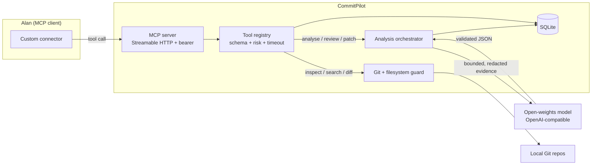
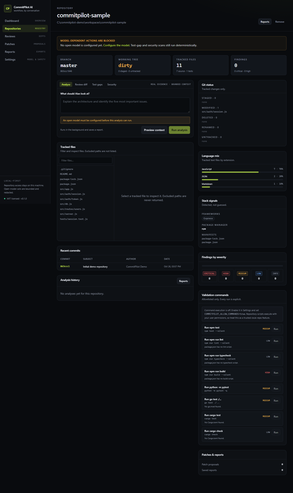
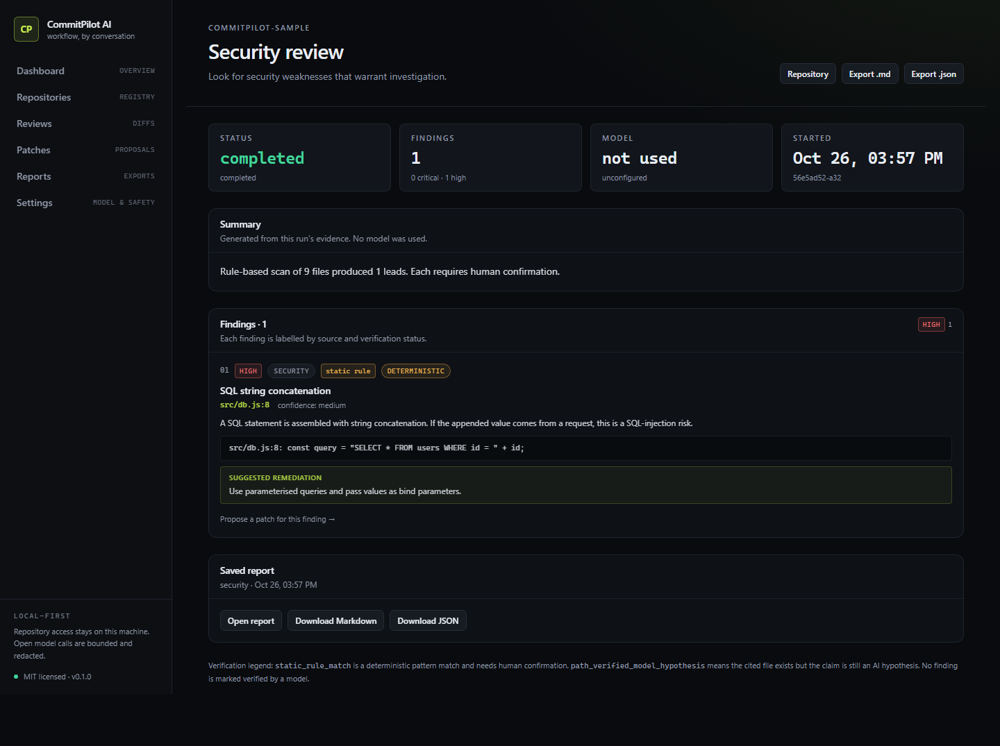
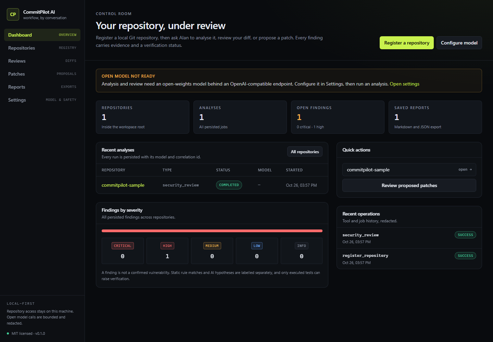
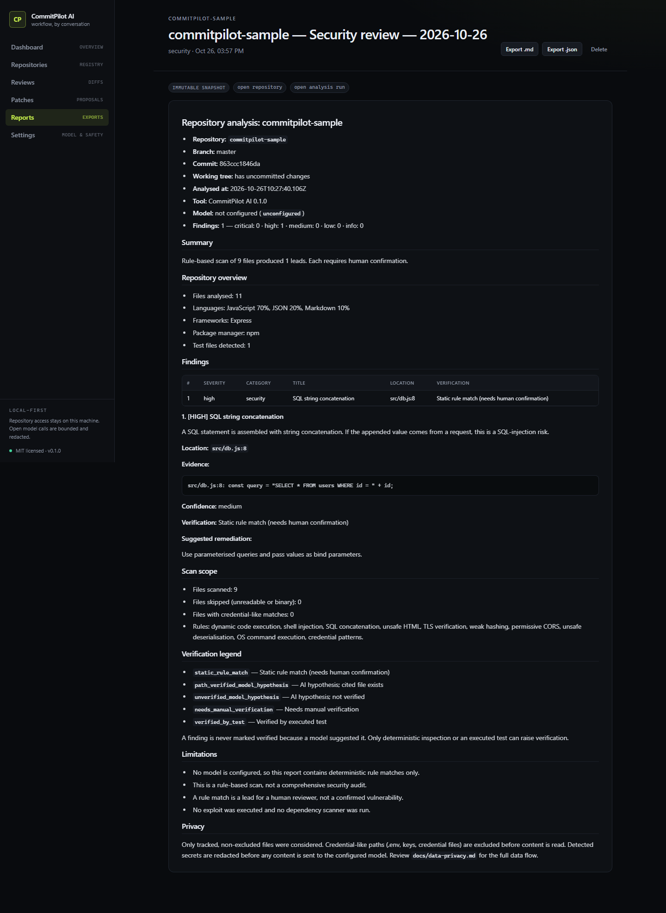

# CommitPilot AI

**Your development workflow, controlled by conversation.**
An open-source repository analysis and code-review assistant for [Alan](https://tryalan.ai), powered by open-weights models.

CommitPilot registers local Git repositories, inspects real files and diffs, and exposes a controlled MCP tool surface that Alan can call. A configurable open model turns bounded, redacted evidence into findings. Every finding carries a verification status; deterministic code owns repository access, path validation, patch application, and command execution.

> **Honest status.** The deterministic workflows, the MCP transport, and the model adapter are tested. No live open-model provider was reachable in the build environment, so model-generated findings shown in the demo must come from your configured endpoint. The Alan custom-connector step is documented from Alan's official docs and verified at the MCP protocol level, but was not clicked through inside the Alan desktop app here. See [assumptions](docs/assumptions.md) and [testing](docs/testing.md).

---

## Why it is useful

Most "AI code review" tools answer from the prompt, not the repository. CommitPilot does the opposite:

- **Evidence first.** Files are selected and read by deterministic code. The model never chooses what to open and cannot call tools.
- **No invented paths.** Every cited path is checked against the tracked file set; invented paths and impossible line numbers are stripped.
- **Bounded and redacted.** `git ls-files` scoped, size-limited excerpts, mandatory secret exclusions, and pattern redaction before any content leaves the machine.
- **Nothing writes without you.** Patches are validated with `git apply --check`, backed up, and applied only after an explicit approval and a server-side flag.
- **Failure is visible.** Model outages, timeouts, and malformed responses fail the job. The app never fabricates a report to fill the gap.

---

## How Alan and the open model are used

| Requirement | Implementation |
| --- | --- |
| Alan integration | Alan's documented **custom MCP connector** (`Settings → Plugins → MCP → Add custom connector`). CommitPilot runs an MCP server over Streamable HTTP with bearer-token auth and exposes 14 typed tools. |
| Open model | An `OpenModelProvider` adapter for any OpenAI-compatible chat-completions endpoint. Default documentation target: `qwen2.5-coder` (Apache-2.0) via Ollama or a hosted open-model provider. No GPU required for a 7B model. |
| Model isolation | The model receives only bounded text and returns JSON. It cannot call tools, change permissions, or choose files. |
| Licence clarity | CommitPilot is MIT. The model is **not** bundled; you choose and license it. See [model integration](docs/model-integration.md). |



---

## Screenshots

Captured from the production build by the Playwright E2E run (`npm run test:e2e`) against the synthetic demo repository. No model was configured, so the analysis shown is the deterministic security scan — exactly what the app reports in that state.

| Repository workspace | Security review with evidence |
| --- | --- |
|  |  |

| Dashboard | Saved report |
| --- | --- |
|  |  |

More: [settings and connector](docs/screenshots/06-settings.png) · [empty dashboard](docs/screenshots/01-dashboard-empty.png).

---

## What works

| Area | Capability | Status |
| --- | --- | --- |
| Registry | Register, list, inspect, remove local repositories; workspace-root containment with symlink resolution | Verified |
| Explorer | Branch, status, commits, languages, frameworks, manifests, tracked-file viewer | Verified |
| Analysis | Model-backed architecture summary, findings, evidence, verification status, saved report | Adapter + orchestration verified; live model call requires your endpoint |
| Review | Unstaged/staged/commit-range diffs reviewed with real diff context | Same as analysis |
| Security | Deterministic rule scan + optional model assessment, labelled as leads | Verified |
| Test gaps | Deterministic module-to-test mapping + optional model review | Verified |
| Search | `git grep` over tracked, non-excluded files + optional model summary | Verified |
| Patches | Model diff → shape checks → `git apply --check` → approve/reject → backup + apply | Verified |
| Commands | Allowlisted `npm test`, `npm run lint/typecheck/build`, `pytest`, `go test`, `cargo test/check`; two server gates + per-run confirmation | Verified (rejection paths and gating) |
| Reports | Markdown + JSON export with findings, evidence, verification, limitations | Verified |
| Alan connector | MCP Streamable HTTP, bearer auth, 14 tools, structured errors | Verified at protocol level |
| UI | Dashboard, repository explorer, analysis, review, patch review, reports, settings | Verified by runtime smoke + Playwright |

---

## Quickstart

Requirements: **Node.js ≥ 22.5** (uses the built-in `node:sqlite`), Git on `PATH`. No GPU.

```bash
git clone <your-fork-url> commitpilot
cd commitpilot
npm ci
cp .env.example .env.local     # web app reads .env.local
cp .env.example .env           # the MCP process reads .env
```

Generate the MCP token and put it in both files:

```bash
node -e "console.log(require('crypto').randomBytes(32).toString('base64url'))"
```

Start the web app and the MCP server in two terminals:

```bash
npm run dev     # http://127.0.0.1:3000
npm run mcp     # http://127.0.0.1:4319/mcp
```

Create the synthetic demo repository and register it in the UI:

```bash
npm run demo:setup
```

The script prints an absolute path inside `.workspaces/`. Paste it into **Repositories → Register**. It leaves one uncommitted regression so the review workflow has a real diff.

### Connect Alan

1. Start `npm run mcp`.
2. In Alan: **Settings → Plugins → MCP → Add custom connector**.
3. URL: `http://127.0.0.1:4319/mcp` (or your authenticated HTTPS tunnel).
4. Add header `Authorization: Bearer <COMMITPILOT_MCP_TOKEN>`.
5. Ask: *"List my repositories, inspect the demo repo, and explain its authentication flow."*

Full detail, including what was verified: [docs/alan-integration.md](docs/alan-integration.md).

### Configure an open model

**Local, no key, no GPU (Ollama):**

```bash
ollama pull qwen2.5-coder:7b-instruct
```

```dotenv
OPENMODEL_BASE_URL=http://127.0.0.1:11434/v1
OPENMODEL_MODEL=qwen2.5-coder:7b-instruct
```

**Hosted open-weights endpoint:** set the base URL, model id, and API key in Settings (stored encrypted server-side) or via env. If the endpoint is not loopback, you must also allow remote model use in Settings. Nothing is sent until both are set.

The model must support OpenAI-compatible `POST /chat/completions`. JSON mode is used when available and automatically retried without it if the server rejects it.

---

## Safety model

- **Containment:** every path is resolved with `realpath` and checked with `path.relative` against the workspace root; symlinks cannot escape. Then `.git` must exist. The same guard is applied to every later read.
- **Secrets:** `.env*`, private keys, credential files, dependency/build directories, and binaries are excluded by default. These exclusions are mandatory and cannot be removed by configuration.
- **Redaction:** credential patterns are replaced before content is sent to a model or written to a report.
- **Prompt injection:** repository content is fenced and declared untrusted. The model has no tools and cannot grant itself permissions; the token "ignore previous instructions" inside a source file is just text.
- **Patches:** no new/deleted/renamed files, `a/`/`b/` prefixes required, every path tracked, `git apply --check` before approval, backups before write, apply flag + per-patch confirmation.
- **Commands:** structured allowlist, `execFile` without a shell, filtered environment (no app secrets), timeouts, output caps and redaction.
- **Local-first:** the web server and MCP server bind `127.0.0.1` by default. Cross-origin JSON requests are rejected.

Details: [security](docs/security.md) · [threat model](docs/threat-model.md) · [data privacy](docs/data-privacy.md).

---

## Verification

Run everything:

```bash
npm run verify      # typecheck + lint + tests
npm run build       # production build
npm run smoke       # starts the production build and exercises 20 runtime checks
```

Measured in this environment (Windows, Node 24.21, Git 2.45):

| Check | Result |
| --- | --- |
| `tsc --noEmit` | pass |
| `eslint .` | pass |
| Vitest | **92 tests / 12 files passed** |
| Production build | pass (34 routes) |
| Runtime smoke | **20/20 checks** |
| Playwright browser E2E | **1 workflow passed** (register → scan → report → export) |
| Dependency audit | **0 blocking advisories** (documented exceptions only) |
| MCP protocol test | 6/6 (auth, tool list, structured calls, error paths) |

Actual outputs and the test matrix: [docs/testing.md](docs/testing.md).

---

## Known limitations

- **Live model call not verified here.** No provider credentials or local model were available in the build environment. The adapter is verified against a real HTTP OpenAI-compatible test server, including timeouts, 5xx, and malformed responses.
- **Alan UI click-through not verified.** The connector contract is tested with the official MCP SDK; adding it inside the Alan desktop app needs your account.
- **Local-only repository access.** Hosted multi-tenant operation is not implemented. A public deployment must not reuse this filesystem model; add authentication and per-user repository isolation first.
- **No dependency vulnerability scanner.** Security review is intentionally rule-based and clearly labelled as leads.
- **Command sandboxing is limited.** Allowlisted commands run as your user, with a filtered environment and timeouts. Full OS sandboxing and network denial are not provided; keep the flags off if that matters.
- **Single-process job runner.** Jobs are persisted in SQLite and stale work is marked failed on restart, but this is not a distributed queue.
- **Coverage is heuristic.** "Test gap" means no test file references the module name; it is not line coverage.

---

## Project layout

```
src/
  app/                 Next.js App Router pages and API routes
  components/          UI primitives and feature panels
  server/
    analysis/          evidence, rules, test gaps, search, orchestrator, verification
    commands/          allowlisted command registry and runner
    config/            env, persisted settings, encrypted credentials
    db/                SQLite client, migrations, stores
    fs/                path guard, exclusions, safe reads
    git/               fixed-argument git wrapper and diff parsing
    http/              API helpers
    inspection/        repository overview
    jobs/              in-process, persisted job runner
    models/            open-model adapter, prompts, response validation
    observability/     structured logs, redaction, metrics
    patches/           proposal workflow, validation, apply
    reports/           Markdown/JSON report rendering
    tools/             registry, dispatcher, MCP tool definitions
  mcp/                 MCP Streamable HTTP and stdio entry points
tests/                 unit, integration, security
docs/                  architecture, security, privacy, testing, deployment, demo
demo/sample-repo/      synthetic demo repository (no personal data)
```

---

## Contributing

Issues and pull requests are welcome. See [CONTRIBUTING.md](CONTRIBUTING.md). Do not include real credentials, private repository contents, or customer data in fixtures.

## License

MIT — see [LICENSE](LICENSE). Model weights and provider terms are separate; see [docs/model-integration.md](docs/model-integration.md).