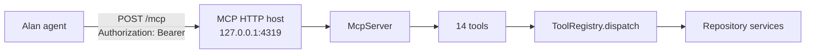

# Alan integration

## Mechanism (verified against Alan's documentation)

Alan documents MCP as the way to connect an external service: *"The MCP tab lists services your agents can use… choose **Add custom connector** for your own MCP server."* — [Alan Docs → Plugins and MCP](https://docs.tryalan.ai/docs/skills/plugins-and-mcp), read 2026-10-26.

CommitPilot therefore ships a standards-compliant **MCP server over Streamable HTTP**, built with the official `@modelcontextprotocol/sdk`. A stdio entry point exists for local agents that launch child processes.



| Item | Value |
| --- | --- |
| Transport | MCP Streamable HTTP, stateless (`sessionIdGenerator: undefined`) |
| Endpoint | `http://127.0.0.1:4319/mcp` by default (`COMMITPILOT_MCP_HOST/PORT`) |
| Auth | `Authorization: Bearer <COMMITPILOT_MCP_TOKEN>`; constant-time comparison |
| Rate limit | 120 requests / minute / process |
| Health | `GET /health` (unauthenticated, no repository data) |
| Tool count | 14 |
| Error shape | MCP `isError` result containing `{ "error": { "code", "message" } }` |
| Logging | JSON to stdout, redacted, no prompts or file contents |

## Tools

| Tool | Risk | Confirmation | Purpose |
| --- | --- | --- | --- |
| `list_repositories` | read | — | Discover registered repository ids |
| `inspect_repository` | read | — | Branch, status, languages, frameworks, tests, optional file list |
| `analyze_repository` | read | — | Model-backed architecture analysis with evidence |
| `review_git_changes` | read | — | Review unstaged/staged/range diffs |
| `search_code` | read | — | Natural-language search over tracked files + optional model summary |
| `analyze_test_gaps` | read | — | Deterministic coverage mapping + optional model review |
| `review_security` | read | — | Deterministic security rules + optional model assessment |
| `propose_patch` | read | — | Generate and validate a unified diff (no write) |
| `get_analysis_report` | read | — | Fetch findings/report by job or report id |
| `list_reports` | read | — | Browse saved reports |
| `list_validation_commands` | read | — | Show the allowlist and availability |
| `apply_patch` | **write** | `confirm: true` | Approve or reject a patch |
| `run_validation_command` | **write** | `confirm: true` | Run one allowlisted command |
| `get_health` | read | — | App/model health and counters |

Each tool has a Zod input schema (converted to JSON Schema by the SDK), an output schema validated after execution, a timeout, and MCP annotations (`readOnlyHint`, `destructiveHint`, `idempotentHint`, `openWorldHint`). Model output is never allowed to invoke a tool.

## Input and output contracts

Example: `inspect_repository`

```json
{
  "repositoryId": "repo_…",
  "includeFiles": true
}
```

Response (truncated):

```json
{
  "repository": { "id": "repo_…", "name": "taskflow-api", "path": "…" },
  "overview": {
    "branch": "main",
    "isDirty": true,
    "fileCount": 9,
    "languages": [{ "language": "JavaScript", "files": 6, "percent": 86 }],
    "frameworks": ["Express"],
    "testFileCount": 1
  },
  "status": { "staged": [], "modified": ["src/auth/session.js"], "untracked": [] },
  "files": ["README.md", "package.json", "src/app.js", "…"]
}
```

Example error:

```json
{
  "error": {
    "code": "REPOSITORY_NOT_FOUND",
    "message": "The selected repository is not registered."
  }
}
```

No stack traces, paths outside the workspace, or credentials appear in errors.

## Connecting it in Alan

1. Set a token in `.env`:
   ```bash
   node -e "console.log(require('crypto').randomBytes(32).toString('base64url'))"
   # COMMITPILOT_MCP_TOKEN=<token>
   ```
2. Start the server: `npm run mcp`. It refuses to start without a token.
3. In Alan: **Settings → Plugins → MCP → Add custom connector**.
4. Name: `CommitPilot`. URL: `http://127.0.0.1:4319/mcp`.
5. Add header: `Authorization: Bearer <token>`.
6. In a session, ask: *"List my repositories."* then *"Inspect the taskflow demo and explain how authentication works."*

If Alan runs in the cloud and CommitPilot runs on your laptop, you need an authenticated tunnel (for example a private HTTPS endpoint) and must set `COMMITPILOT_PUBLIC_URL` so the Settings page displays the right URL. Do not expose the MCP port publicly without a token and TLS.

Generic MCP client configuration (for other clients):

```json
{
  "mcpServers": {
    "commitpilot": {
      "type": "http",
      "url": "http://127.0.0.1:4319/mcp",
      "headers": { "Authorization": "Bearer <COMMITPILOT_MCP_TOKEN>" }
    }
  }
}
```

## What was actually tested

**Verified in this environment** (`tests/integration/mcp.test.ts`, 6 tests):

- The server starts from a clean process and answers `GET /health`.
- A `POST /mcp` request without a bearer token returns **401** with `UNAUTHORIZED`.
- The official MCP SDK client connects over Streamable HTTP with the bearer header.
- `tools/list` returns all seven required capabilities plus the supporting tools.
- `list_repositories` and `inspect_repository` return structured results over the wire.
- An unknown tool is rejected by the MCP layer.
- `apply_patch` without `confirm: true` returns `TOOL_FORBIDDEN`.

```
✓ tests/integration/mcp.test.ts (6 tests)
```

**Not verified here:** clicking *Add custom connector* inside the Alan desktop app, and a cloud Alan agent invoking these tools. That requires the participant's signed-in Alan account and (for cloud) a reachable tunnel. The protocol contract is tested; the vendor-side UI step is documented, not claimed as executed.

## Troubleshooting

| Symptom | Cause |
| --- | --- |
| Server exits with "COMMITPILOT_MCP_TOKEN is not set" | Generate a token and add it to `.env` |
| 401 from the connector | Missing/incorrect `Authorization` header, or token mismatch |
| Connection refused | `npm run mcp` is not running, or host/port differ |
| Tools list is empty | Client connected to the wrong path; the endpoint is `/mcp`, not `/` |
| Analysis tool returns `MODEL_NOT_CONFIGURED` | No open model configured; see [model-integration.md](model-integration.md) |