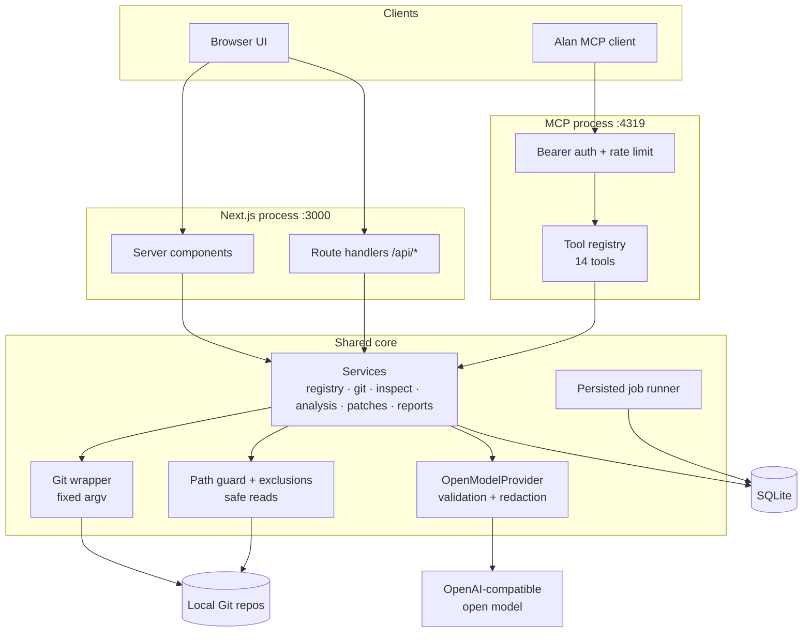
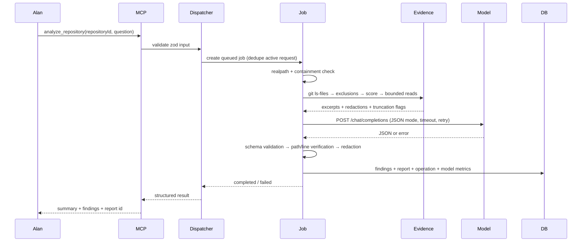

# Architecture

## Shape

CommitPilot is a single TypeScript codebase with two long-lived processes:

1. **Web app** — Next.js App Router. Server components read SQLite directly; route handlers expose the JSON API used by client components.
2. **MCP server** — the same core modules, exposed through the official `@modelcontextprotocol/sdk` over Streamable HTTP (and stdio for local agents). This is the Alan integration surface.

Both processes open the same SQLite database file in WAL mode. The web app is not the MCP server's proxy, and the MCP server has no web dependency: business logic lives in `src/server/**` and is imported by both. There is no copy of the tool logic in route handlers.

Running the MCP server as its own process is deliberate: Alan's connector needs a stable tool endpoint that is independent of a browser session, and it can be exposed through an authenticated tunnel without exposing the UI.



## Why this stack

- **Next.js App Router** keeps the UI, server rendering, and HTTP API in one deployable for a local-first tool, while server components avoid a client-side data layer.
- **SQLite via `node:sqlite`** is the simplest reliable persistence for a single machine. It removes native module build risk and ships with Node ≥ 22.5. Migrations are real SQL files applied in order and recorded in `schema_migrations`.
- **A separate MCP process** matches the integration requirement. It also means a crashed browser tab cannot take down the tool endpoint.
- **No ORM** keeps the data layer explicit and small (six tables plus settings, operations, and model-call metrics). Every query is parameterised.

## Core modules

| Module | Responsibility |
| --- | --- |
| `server/config` | env parsing, persisted settings, encrypted credential storage |
| `server/db` | connection, migrations, repositories, jobs, findings, reviews, patches, reports, operations |
| `server/fs/pathGuard` | workspace containment, `realpath`, device names, repository-relative resolution |
| `server/fs/exclusions` | mandatory secret/dependency exclusions and user additions |
| `server/git/git` | the only place Git is executed; fixed argv, filtered env, timeouts |
| `server/inspection` | repository overview from tracked files and git status |
| `server/analysis` | evidence selection, static rules, test gaps, search, orchestration, finding verification |
| `server/models` | provider interface, OpenAI-compatible transport, prompts, strict JSON validation |
| `server/tools` | registry, dispatcher, input/output validation, risk and confirmation rules |
| `server/patches` | proposal workflow, diff shape checks, `git apply --check`, backup + apply |
| `server/commands` | allowlisted command definitions and runner |
| `server/reports` | Markdown and JSON rendering, filename sanitisation |
| `server/observability` | JSON logs, redaction, in-process counters and latency |
| `mcp` | MCP server factory, Streamable HTTP host, stdio entry |

## Repository analysis data flow



Key properties:

- The model never sees a file the deterministic layer did not choose.
- Every cited path is checked against the tracked file set; invented paths become `null`.
- Line numbers beyond the file length downgrade the finding to `needs_manual_verification`.
- A finding produced by the model can never become "verified"; only deterministic rules and executed tests carry that status.
- If the model fails, the job is marked failed and no report is written.

## Job lifecycle

Jobs are rows, not promises in memory:

```
queued → running → completed
                 ↘ failed
                 ↘ cancelled
```

- `startAnalysis` deduplicates an identical active request instead of creating a second job.
- The in-process runner updates stage/progress (`inspecting`, `collecting_evidence`, `calling_model`, `verifying`, `saving`).
- On process start, `reapStaleJobs` marks interrupted `queued`/`running` rows as failed so nothing hangs forever.
- Cancellation is a status update; the runner checks it before persisting findings. A model request already in flight may finish, but its result is discarded.
- A report is written only after verification and only for completed jobs.

## Persistence

| Table | Purpose |
| --- | --- |
| `repositories` | canonical path, display name, timestamps |
| `analysis_jobs` | type, status, stage, progress, request, summary, model, correlation id, error |
| `findings` | category, severity, evidence, path/lines, confidence, verification, source, remediation |
| `reviews` | diff mode, commit range, changed files, summary, linked job |
| `patches` | title, rationale, diff, files, status, validation snapshot |
| `reports` | immutable Markdown + JSON snapshot linked to a job |
| `operations` | audit trail of registrations, jobs, patches, commands |
| `settings` | one JSON document plus an encrypted credential |
| `model_calls` | latency/outcome metrics without prompts or file content |

Repository contents are never stored. Only excerpts already sent to the model exist transiently in memory. Reports contain findings and evidence snippets, not full files.

## Failure handling

| Failure | Behaviour |
| --- | --- |
| Repository path moved outside the root | Operation rejected; the registration is kept and the UI shows the reason |
| Git missing or unreadable | Structured `REPOSITORY_INVALID`; no partial analysis |
| Model unreachable / 5xx / 429 | Bounded retry, then `MODEL_UNAVAILABLE`/`MODEL_RATE_LIMITED`; job failed, no report |
| Model timeout | `MODEL_TIMEOUT`; job failed |
| Malformed JSON / wrong shape | `MODEL_INVALID_RESPONSE`; job failed |
| Partial malformed findings | Invalid entries dropped and counted; if none survive, the job fails |
| Patch context mismatch | `git apply --check` fails; proposal marked `invalid`, nothing written |
| Apply flag off | `PATCH_APPLY_DISABLED` before any write |
| Command gate off | `COMMAND_EXECUTION_DISABLED` before spawn |

## Security boundaries

1. **Workspace boundary** — all repository and file access resolves through one guard.
2. **Process boundary** — the MCP endpoint requires a bearer token and rate-limits; it binds loopback by default.
3. **Model boundary** — text-only, bounded, redacted, schema-validated output; no tool access.
4. **Write boundary** — a separate approval path with its own flag, diff validation, and backups.
5. **Execution boundary** — fixed argv, filtered env, timeout, output caps; never a model-generated command string.

See [threat-model.md](threat-model.md) for the threat-by-threat analysis.